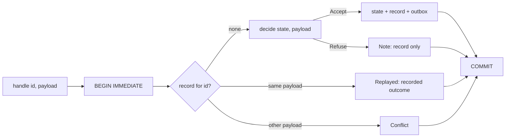

# commands

Retry-safe commands. Each command has an id and a payload. The first delivery of an id runs your `decide` and commits the new domain state, a record of the outcome, and the outbox effects in one SQLite transaction. A retry of the id with the same payload writes nothing and replays the recorded outcome. A retry with a different payload is a conflict.

```bend
import bend-kit-commands@0.3.0.0/commands.bend as C
```

It imports `bend-kit-sqlite@0.1.0.1` and `bend-kit-bytes@0.3.3.0`. The store's database and statement handles are that sqlite version's `U32` ids. Payloads, states, results, and effects are that bytes version's `Bytes.Bytes`.



## Example

A running total. Each payload is an amount in decimal, the result is the new total, and each new command emits one effect.

```bend
import Base
import bend-kit-bytes@0.3.3.0/bytes.bend as Bytes
import bend-kit-commands@0.3.0.0/commands.bend as C

def num(b: Bytes.Bytes) -> U32:
  Maybe.default(&2, U32, Bytes.u32.read(b), 0)

def decide(s: Bytes.Bytes, p: Bytes.Bytes) -> C.Decision<Bytes.Bytes, Bytes.Bytes, Bytes.Bytes>:
  +t = (num(s) + num(p) : U32)
  C.Accept{Bytes.u32.show(t), Bytes.u32.show(t), [Bytes.append(Bytes.from_string("total="), Bytes.u32.show(t))]}

def main() -> IO(Unit):
  do IO<Unit>:
    +st : C.Store <- IO.try(C.Store, C.open("totals.db", Bytes.from_string("0"), 5000))
    a : C.Reply<Bytes.Bytes> <- IO.try(C.Reply<Bytes.Bytes>, C.handle(~decide, st, "evt_1", Bytes.from_string("5"), 1760000000))
    b : C.Reply<Bytes.Bytes> <- IO.try(C.Reply<Bytes.Bytes>, C.handle(~decide, st, "evt_1", Bytes.from_string("5"), 1760000060))
    IO.try(Unit, C.close(st))
```

`a` is `Fresh{Accepted{"5"}}` and `b` is `Replayed{Accepted{"5"}}`, with each result as bytes. The total stays 5.

[ledger.bend](ledger.bend) is the full consumer: a payment ledger fed by webhook events. A payload is strict JSON bytes, such as the raw body of a webhook delivery: `{"account":"acct_1","credit":500}` or `{"account":"acct_1","debit":200}`. The state is a JSON object of balances, kept in a `bend-kit-collections` `OMap` while `decide` runs. A debit past the balance is refused, and each applied event emits `account=balance` to the outbox.

## API

`~decide: Bytes -> Bytes -> Decision<Bytes, Bytes, Bytes>` takes the committed state and the payload, where `Bytes` is `Bytes.Bytes`. It answers `Accept{state, result, effects}` or `Refuse{result}`. It is pure, so it cannot run an effect: put the effect in the outbox.

| def | does |
|---|---|
| `open(path, init, wait)` | Opens or creates the database and its tables. A new database starts with state `init`; an existing one keeps its state. A write waits up to `wait` ms for another connection's transaction, then fails with `SQLITE_BUSY` (5). |
| `handle(~decide, st, id, payload, at)` | Runs one command in one `BEGIN IMMEDIATE` transaction. `at` is the record's time, in seconds, for `prune`. On a failure it rolls back and answers `Fail`; nothing was committed, so retry the call. |
| `state(st)` | The committed domain state. |
| `outbox.next(st)` | The oldest undelivered effect as `Pending{seq, id, effect}`, or `None`. |
| `outbox.ack(st, seq)` | Removes a delivered effect. |
| `prune(st, before)` | Forgets every record whose `at` is below `before`. |
| `close(st)` | Finalizes the statements and closes the database. |

`Reply` is `Fresh{outcome}`, `Replayed{outcome}`, or `Conflict{}`. `Outcome` is `Accepted{result}` or `Refused{result}`. A refusal is recorded like an acceptance, so a retry gets the same answer even after the state changes.

`step(~S, ~P, ~R, ~E, ~eq, ~dup_p, ~dup_r, ~decide, found, s, p, at)` is the pure processor that `handle` runs inside the transaction. Its types may be affine (`Type`). `dup_p` and `dup_r` copy a payload and a result, because a new command's payload goes to `decide` and to the record, and its result goes to the record and to the reply. It answers `Write{state, record, reply, effects}` for an acceptance, `Note{record, reply}` for a refusal, which `handle` commits, or `Keep{reply}`, which writes nothing. `handle` passes `same` (`Bytes.eq`) as `eq` and `Bytes.clone` as both copies. Use `step` with another store.

### Tables

| table | row |
|---|---|
| `commands_state` | one row, `k = 0`: the domain state as a BLOB |
| `commands_seen` | `id` (primary key), `payload` (BLOB), `kind` (1 accepted, 2 refused), `result` (BLOB), `at` |
| `commands_outbox` | `seq` (autoincrement), `id`, `effect` (BLOB) |

The id is text. A database made by 0.1 stores text where 0.2 reads BLOBs, so 0.2 fails on its rows with `SQLITE_MISMATCH` (20). Start 0.2 on a new file.

## Payload identity

Two payloads are the same command when their bytes are equal, byte for byte, NUL included. The store compares the whole payload, not a hash, so no collision can merge two commands. Send one canonical encoding per command: the raw body of a webhook delivery, or a canonical JSON or CBOR encoding. `ledger.bend` parses with unique keys, so a payload with a repeated key is refused rather than read two ways.

## Retention

A record lives until `prune` removes it. Deduplication covers only the records that the store still holds: after `prune(st, before)`, a retry of an id recorded before `before` runs as a new command and applies again. Choose `before` to be older than the longest time a sender can retry. Stripe retries webhooks for three days, and GitHub does not redeliver on its own. `prune` does not touch the outbox.

## Crash points

SQLite makes the transaction all or nothing, so a crash leaves one of two states:

| crash | after restart |
|---|---|
| before `COMMIT` returns | Nothing of the command is stored. A retry runs it as new. |
| after `COMMIT`, before the caller sees the reply | Everything is stored. A retry replays the recorded outcome. |
| after an effect is delivered, before `outbox.ack` | The effect is still pending, and the next `outbox.next` delivers it again. |

## External effects

This is not exactly-once execution of external effects. A command's effects are stored in the same transaction as its state, so an effect exists exactly when the command was applied. Delivery is at least once: deliver, then `outbox.ack`. A crash between the two delivers the effect again, so the recipient must deduplicate by the command id that `Pending` carries.

## Laws

`LAWS.bend` states them for every domain: any state, payload, result, and effect types, any `eq`, `dup_p`, and `dup_r`, and any `decide`. `PROOF.bend` proves them over `step`.

| law | claim |
|---|---|
| `duplicate_replays` | When the recorded payload equals the new one, `step` writes nothing, emits no effect, and replies `Replayed` with the recorded outcome. |
| `conflict_rejected` | When the payloads differ, `step` writes nothing, emits no effect, and replies `Conflict`. |
| `accept_recorded` | When `dup_p` and `dup_r` copy and `decide` accepts, `step` writes the new state, the effects, and a record whose outcome is exactly the reply's. |
| `refuse_keeps_state` | When `decide` refuses, `step` answers `Note`: a record of the refusal, and no state or effect. |
| `retry_replays` | When `eq` is reflexive and `dup_p` and `dup_r` copy, a retry against what the first `step` wrote writes nothing and replays the first outcome, at any later time. |

## Trust boundary

- **Payload comparison and copies.** The laws take `eq`, `dup_p`, and `dup_r` as given. `retry_replays` needs `eq(x, x)` and `dup(x) == (x, x)` for every `x`. The store uses `same`, which is `Bytes.eq`, and `Bytes.clone`. Neither fact is proven.
- **The store.** The laws are about `step`. `handle` gives `step` the record that `commands_seen` holds for the id, commits `Write` with one `UPDATE` and two kinds of `INSERT`, and commits `Note` with one `INSERT`. That wiring, SQLite's atomicity, and `BEGIN IMMEDIATE`'s isolation are trust assumptions. `check.bend` tests them; it is not a proof.
- **Durability.** A `COMMIT` is durable as SQLite's journal mode and `synchronous` setting make it. The defaults (rollback journal, `FULL`) sync before `COMMIT` returns.
- **Concurrency.** Any number of processes may open one file. `BEGIN IMMEDIATE` takes the write lock before the lookup, so two deliveries of one id never both find no record. One `Store` serves one task at a time.
- **Size.** The domain state is one BLOB row, read by every command and written by every accepted one. Keep it small, or keep large state in your own tables.

## Checks

`bend check.bend` runs the ledger against a file database:

- a new event applies, a duplicate replays its result, and an id reused with another payload is a conflict; neither changes the state;
- an overdraft is refused, and a retry replays the refusal; payloads without an amount or with a repeated key are refused;
- a payload with a NUL byte is recorded and replays, and a payload that differs only after the NUL byte is a conflict;
- after close and reopen, a retry replays, and `init` is ignored;
- a child process (`child.bend crash`) writes the state and a record inside a transaction and dies before `COMMIT`. After a restart, both are gone, and the event applies once;
- writer A is inside its transaction for an event and has found no record. Writer B delivers the same event: it waits, then fails with `SQLITE_BUSY` and commits nothing. A commits, and B's retry replays A's result;
- two processes deliver the same 400 events at once; each applies once, and the outbox holds one effect for each;
- the outbox delivers in commit order, and `ack` empties it;
- `prune` forgets old records, so an old id applies again, while a newer id still replays.

`bench/` times `handle` for new commands and duplicates. See [bench/README.md](bench/README.md).
