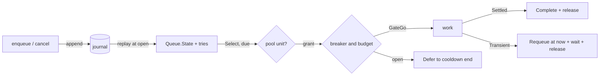

# runner

A durable job runner (an outbox). It keeps a scheduler queue in a journal, bounds the attempts that run at once with a resources pool, and retries failed jobs with retry's policy and a breaker per target.

```bend
import bend-kit-runner@0.3.0.0/runner.bend as R
```

It imports `bend-kit-journal@0.2.0.0`, `bend-kit-scheduler@0.3.0.0`, `bend-kit-resources@0.1.0.0`, `bend-kit-retry@0.1.0.0`, `bend-kit-time@0.2.0.0`, `bend-kit-collections@0.1.3.0`, and `bend-kit-bytes@0.3.2.0`. Payload codecs take and give that version's `Bytes`. Policies, budgets, and outcomes are `bend-kit-retry@0.1.0.0` types; tickets are `bend-kit-scheduler@0.3.0.0` types.



## Example

A job is a `String`. `work` prints it and succeeds. The journal file keeps the jobs across restarts: a job that a crash interrupted runs again at the next `open`.

```bend
import Base
import bend-kit-bytes@0.3.2.0/bytes.bend as Bytes
import bend-kit-retry@0.1.0.0/retry.bend as Retry
import bend-kit-runner@0.3.0.0/runner.bend as R

def penc(s: String) -> Bytes.Bytes:
  Bytes.from_string(s)

def pdec(b: Bytes.Bytes) -> Maybe<&2, String>:
  Some{Bytes.to_string(b)}

def target(s: String) -> String:
  "printer"

def work(s: String) -> IO(Retry.Outcome):
  do IO<Retry.Outcome>:
    IO.print("job: " ++ s)
    return Retry.Settled{}

# 3 attempts, 100 ms first backoff, 5 s cap. 5 failures in 60 s open the breaker for 30 s.
def config() -> R.Config:
  R.Config{Retry.Policy{3n, 100n, 5000, None{}}, Retry.Circuit{5n, 60000n, 30000n, 1n}, 50}

def added(y: R.Runner<String> & R.Out(Nat)) -> IO(R.Runner<String>):
  match y:
    case (r, Done{id}):
      IO.pure(R.Runner<String>, r)
    case (r, Fail{(c, m)}):
      IO.die(R.Runner<String>, 1, m)

def done(y: R.Ran(String)) -> IO(Unit):
  match y:
    case (r, Done{u}):
      R.close(String, r)
    case (r, Fail{(c, m)}):
      IO.die(Unit, 1, m)

def main() -> IO(Unit):
  do IO<Unit>:
    r0 : R.Runner<String> <- IO.try(R.Runner<String>, R.open(~String, ~penc, ~pdec, "jobs.journal", 4096, 16777216, config(), 4n))
    r1 : R.Runner<String> & R.Out(Nat) <- R.enqueue(~String, ~penc, r0, 0n, "send the report")
    r2 : R.Runner<String> <- added(r1)
    y : R.Ran(String) <- R.drain(~String, ~penc, ~target, ~work, 1000n, r2)
    done(y)
```

[example.bend](example.bend) is a full webhook outbox: each job signs a Standard Webhooks POST with `bend-kit-webhooks` and sends it through `bend-kit-hairpin`. Its receiver answers 503 once, and the runner requeues that delivery and completes it on the next attempt.

## API

`~penc: A -> Bytes.Bytes` and `~pdec: Bytes.Bytes -> Maybe<&2, A>` encode the payload. `pdec(penc(x))` must be `Some{x}`: the replay laws assume it. `~target: A -> String` names a job's breaker. `~work: A -> IO(Retry.Outcome)` runs one attempt.

| def | does |
|---|---|
| `open(~A, ~penc, ~pdec, path, max, limit, config, capacity)` | Opens or creates the journal at `path` and replays it. Each ticket that was running is requeued at now as a failed attempt. `capacity` bounds the attempts that run at once. |
| `enqueue(~A, ~penc, r, deadline, x)` | Adds a job due at `deadline` (wall-clock ms since the Unix epoch). Answers its ticket id once the record is durable. |
| `cancel(~A, ~penc, r, id)` | Cancels a ticket. An attempt that runs finishes, but the ticket is never selected again. |
| `tick(~A, ~penc, ~target, ~work, r)` | One round: start an attempt for each due ticket that the pool admits, wait for them all, and record each outcome. `Done{True}` when an attempt ran. |
| `drain(~A, ~penc, ~target, ~work, fuel, r)` | Ticks until no ticket is pending or running, waiting `idle` ms after a round that started nothing. Fails after `fuel` rounds with work left. |
| `state(A, r)` | The runner and a copy of its `State`. |
| `close(A, r)` | Closes the journal. |

`Config{policy, circuit, idle}`: retry's `Policy` for every ticket, the `Circuit` of each target's breaker, and `drain`'s wait. `max` caps one record's octets and `limit` caps the journal file, as in `journal`. A failed append stops the runner: every later call fails until it is reopened.

### Records

Every transition is one journal record, appended and fsynced before the state changes:

| op | appended when | state change |
|---|---|---|
| `Enqueue{deadline, x}` | `enqueue` | `Queue.enqueue`, and a `Try{0, deadline}` under the new id |
| `Select{now}` | a due ticket and a free pool unit | `Queue.select(now)`. Replay runs it at the same `now`, so it takes the same ticket. |
| `Complete{id}` | the attempt settled, or retry stopped | `Queue.complete(id)`, which takes the ticket from the running list, and the `Try` is dropped |
| `Cancel{id}` | `cancel` | `Queue.cancel(id)`, which takes the ticket from both registries, and the `Try` is dropped |
| `Requeue{id, d}` | the attempt failed, or a crash interrupted it | `Queue.requeue(id, d)`, one more failure in the `Try` |
| `Defer{id, d}` | the target's breaker is open | `Queue.requeue(id, d)`, no failure counted |

The record is a u32le tag (1 to 6), then u64le fields, then the payload for `Enqueue`. A ticket's budget is the policy's attempts less its failures, and its deadline is the policy deadline after its first due time. `Select` is journaled so that the replayed queue equals the live one, running list included.

## Laws

`LAWS.bend` states them and `PROOF.bend` proves them over the runner's own `step`, `apply`, `pick`, and `after`.

| law | claim |
|---|---|
| `replay_live` | When every record decodes to its op, replaying the records of any ops gives the state that applying them live gives. |
| `replay_prefix` | The same for the first `k` ops: the committed prefix that recovery keeps after a crash. |
| `complete_never_selected` | After `Complete{i}` and any ops, no `Select` takes ticket `i`. It assumes `i` was issued and was not pending, as a running ticket is. |
| `cancel_never_selected` | After `Cancel{i}` and any ops, no `Select` takes ticket `i`, when `i` was issued. |
| `recovered_never_selected` | The `Complete` claim for the state that `open` replays from the journal. |
| `pick_holds_one` | A picked attempt holds exactly one more pool unit; an idle pick holds none. |
| `pick_bounded` | The units held after a pick never exceed the capacity. |
| `pick_release` | Releasing a picked grant once gives back the pool as it was before the pick. |
| `requeue_wait` | When `retry.plan` waits `w`, the record is `Requeue{id, now + w}`. |
| `requeue_stop` | When `retry.plan` stops, the record is `Complete{id}`. |

`journal`'s `replay` and `roundtrip` laws give the other half of `replay_prefix`: `open` folds exactly the committed records, in order. `scheduler`'s laws give the queue's own behavior, such as `requeue_token`.

## Trust boundary

- **Journal.** Durability is the journal's: a record is on disk when `append` answers `Done`, under the trust assumptions in [journal/README.md](../journal/README.md#trust-boundary).
- **At least once.** A crash after `Select` and before `Complete` reruns the job at the next `open`. A crash after the job's effect and before `Complete` repeats the effect. Make jobs idempotent, as webhook receivers do with the event id.
- **Codec.** The laws assume `pdec(penc(x)) == Some{x}` and that the op codec round-trips. `check.bend` tests the op codec on every op, including 41-bit deadlines. A record that does not decode fails `open` with `EINVAL` (22). Nat fields must stay under 2^64.
- **Wiring.** The laws cover the pure transitions. `open`, `tick`, and `drain` are IO that appends each op before it applies it, and gives each grant back after its attempt. `check.bend` tests that wiring, not a proof.
- **Clock.** Deadlines are wall-clock ms, so they keep their meaning across restarts. A clock that jumps moves every due time with it.
- **Breakers.** Breaker state lives in memory. A restart closes every breaker.
- **One writer, one round at a time.** Nothing locks the journal. `tick` waits for every attempt it starts, so a slow job holds its round.
- **Memory.** `open` reads the whole journal, and the journal grows without bound: completed jobs keep their records.

## Checks

`bend check.bend` runs these on the JS lane:

- the op codec round-trips each op, and rejects short records and unknown tags;
- three jobs drain: two run once, one fails every time and stops after the policy's 3 attempts; reopening replays the same state;
- a child process (`crash.bend`) completes job x, then dies inside job y's attempt. Reopening requeues y as a failed attempt, y runs again, and x does not;
- two failing jobs open their target's breaker; no third attempt starts, and the held jobs wait for the cooldown;
- the webhook example delivers two signed events through a 503.


`bench/` times replay at `open`. See [bench/README.md](bench/README.md).
